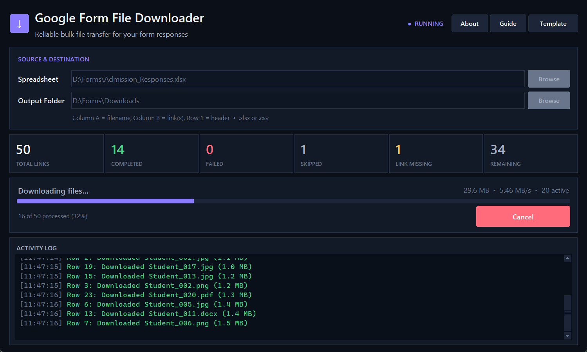
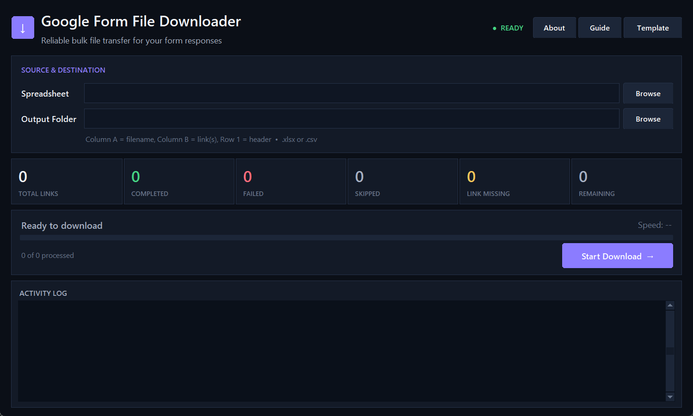
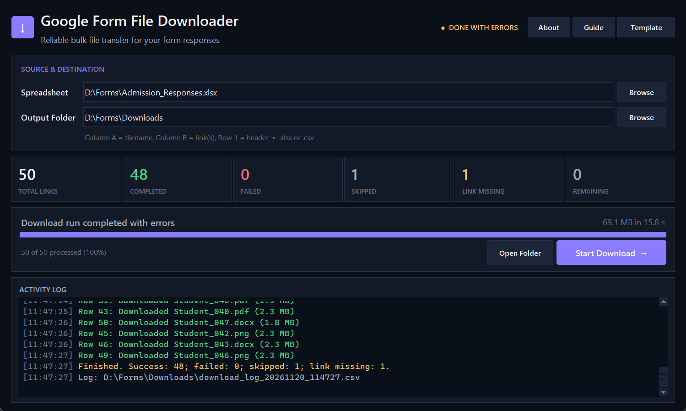
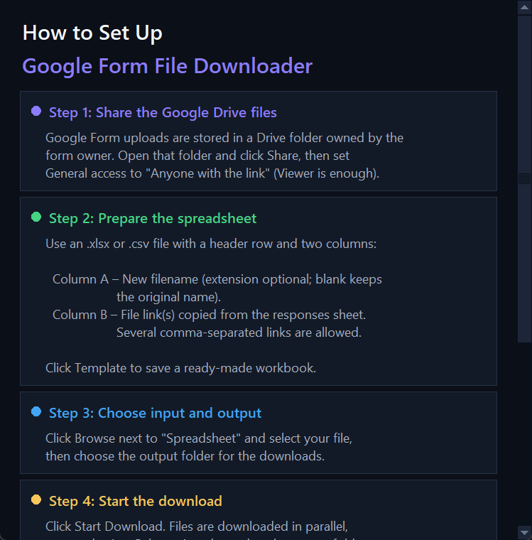
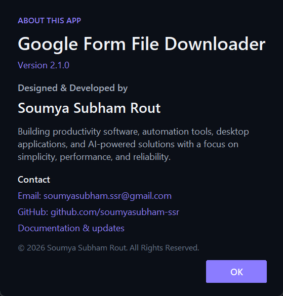

<p align="center">
  
</p>

<h1 align="center">Google Form File Downloader</h1>

<p align="center">
  Bulk-download every file uploaded through a Google Form, renamed the way you want, in one click.
</p>

<p align="center">
  <a href="https://github.com/soumyasubham-ssr/Google-Form-File-Downloader/releases/latest"></a>
  <a href="https://github.com/soumyasubham-ssr/Google-Form-File-Downloader/releases"></a>
  <a href="https://github.com/soumyasubham-ssr/Google-Form-File-Downloader/actions/workflows/ci.yml"></a>
  
</p>

<p align="center">
  <a href="https://github.com/soumyasubham-ssr/Google-Form-File-Downloader/releases/latest"><b>⬇ Download for Windows</b></a> ·
  <a href="docs/USER_GUIDE.md">User Guide</a> ·
  <a href="docs/DEVELOPMENT.md">Developer Guide</a> ·
  <a href="CHANGELOG.md">Changelog</a>
</p>

---

When a Google Form has a **File upload** question, every response contains a Drive link instead of the file itself. Downloading and renaming hundreds of those by hand is slow and error-prone. Google Form File Downloader reads a spreadsheet of *filename → link* pairs, downloads all files in parallel, renames them, and writes a CSV report of what happened to every row.



## Features

- **Google Drive and direct URLs.** Drive sharing links (`open?id=`, `/file/d/…/view`, `uc?id=`) are converted to direct downloads automatically. Any other `http(s)` link is downloaded as-is.
- **Multiple uploads per answer.** Cells with several comma-separated links (how Google Forms stores multi-file answers) are split and each file is downloaded.
- **Fast and resilient.** Up to 20 parallel downloads, connection reuse, and automatic retries on network errors and HTTP 429/5xx responses.
- **Safe renaming.** Column A sets the filename and the extension is added automatically. Invalid characters and reserved Windows names are fixed. Existing files are **never overwritten** (`name_2.pdf`, `name_3.pdf`, …).
- **Smart checks.** Duplicate links are downloaded once. Blank or invalid links are reported. Drive files that aren't shared publicly are flagged clearly instead of being saved as broken HTML pages.
- **Live dashboard.** Shows totals, completed, failed, skipped, missing and remaining counts, live MB/s, and a colour-coded activity log.
- **Cancel any time.** Partial files are cleaned up automatically.
- **CSV audit log.** Every run writes `download_log_<date>_<time>.csv` with the row number, status, saved name, error and byte count for each link.
- **Excel or CSV input.** Reads `.xlsx`/`.xlsm` (including cells that are hyperlinks) and `.csv`. A ready-made template is one click away.
- **Sharp on any display.** Per-monitor high-DPI support, so the UI stays crisp at 100–200 % scaling.

## Quick start

1. **Download** the `.exe` from the [latest release](https://github.com/soumyasubham-ssr/Google-Form-File-Downloader/releases/latest). No installation or Python is needed.
2. **Share the uploads.** In Google Drive, open the form's upload folder → **Share** → *General access*: **Anyone with the link** (Viewer).
3. **Prepare a spreadsheet.** Click **Template** in the app, or use any sheet laid out like this:

   | A – File name | B – Link |
   | --- | --- |
   | Student_001 | https://drive.google.com/open?id=1AbC… |
   | Student_002 | https://drive.google.com/open?id=1XyZ…, https://drive.google.com/open?id=1Pq… |
   | | https://example.com/files/brochure.pdf |

   Row 1 is a header. A blank file name keeps the original name. Tip: in your form's *Responses* sheet, copy the name column into A and the upload column into B.
4. **Run it.** Choose the spreadsheet and output folder, then click **Start Download**.

> Windows SmartScreen may warn about an unrecognised app the first time you run the exe, because it isn't code-signed. Click **More info → Run anyway**. You can check the file against the SHA-256 checksum published with each release.

| Ready | Finished |
| --- | --- |
|  |  |

| Built-in setup guide | About |
| --- | --- |
|  |  |

See the **[User Guide](docs/USER_GUIDE.md)** for the full walkthrough, the log file format and troubleshooting.

## Run from source

Requires Python 3.10+ on Windows (macOS/Linux work too, with Tk installed).

```powershell
git clone https://github.com/soumyasubham-ssr/Google-Form-File-Downloader.git
cd Google-Form-File-Downloader
python -m pip install -r requirements.txt
python google_form_file_downloader.py
```

Or double-click `run_gui_downloader.bat`, which installs the dependencies and starts the app.

## Build the Windows executable

```powershell
python -m pip install -r requirements-dev.txt
python -m pytest
pyinstaller --noconfirm "Google Form File Downloader.spec"
```

The single-file executable is written to `dist\`. See the [Developer Guide](docs/DEVELOPMENT.md) for the architecture and release process.

## Project layout

```text
.
├── gffd/                        Application package
│   ├── core.py                  Download engine, spreadsheet reader, filename rules (no UI)
│   ├── app.py                   Main window
│   ├── dialogs.py               About and Setup Guide dialogs
│   └── widgets.py               Theme, DPI helpers, custom buttons and progress bar
├── tests/                       pytest suite (runs a local HTTP server, no internet needed)
├── assets/                      icon.ico and template.xlsx bundled into the exe
├── docs/                        User guide, developer guide and screenshots
├── tools/make_icon.py           Regenerates the app icon
├── google_form_file_downloader.py   Entry point
└── Google Form File Downloader.spec PyInstaller build recipe
```

## Privacy

The app talks only to the URLs in your spreadsheet. It has no telemetry, accounts or background services. Nothing leaves your computer except the download requests themselves.

## Contributing & security

Issues and pull requests are welcome. See [CONTRIBUTING.md](CONTRIBUTING.md). To report a vulnerability, follow [SECURITY.md](SECURITY.md).

## License

Copyright © 2026 Soumya Subham Rout. All rights reserved. See [LICENSE](LICENSE).
