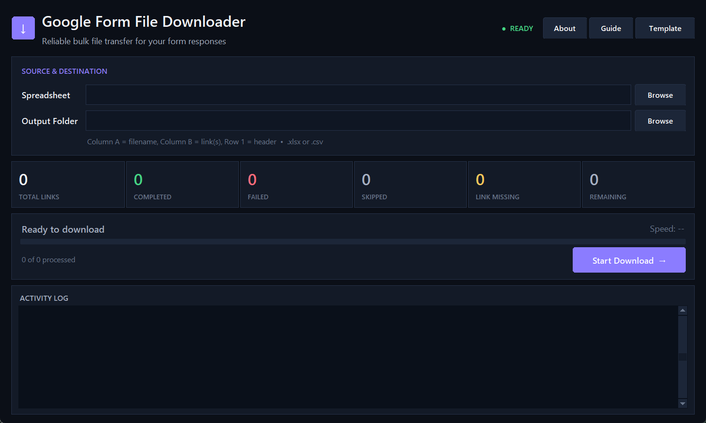
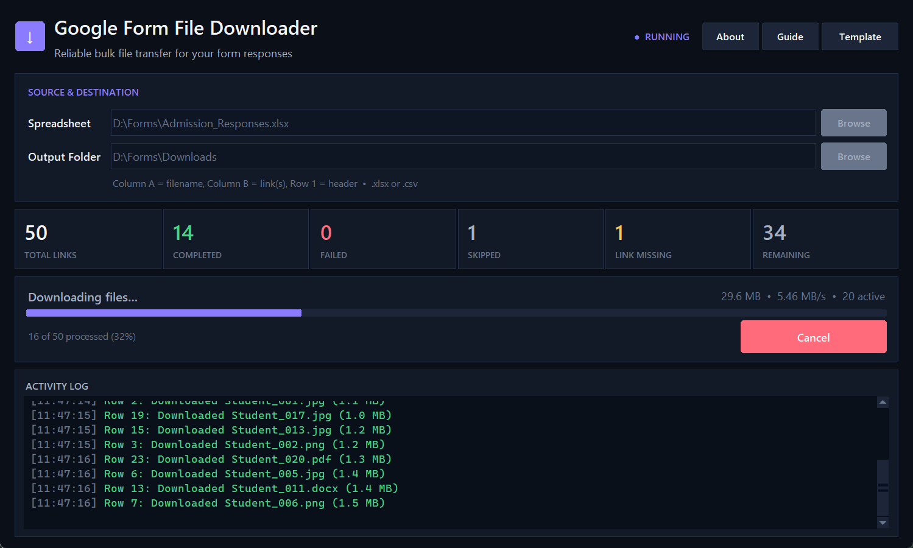

# User Guide

This guide walks through a complete run of **Google Form File Downloader**, from sharing the uploads to reading the log.

- [1. Install](#1-install)
- [2. Share the uploaded files](#2-share-the-uploaded-files)
- [3. Prepare the spreadsheet](#3-prepare-the-spreadsheet)
- [4. Run a download](#4-run-a-download)
- [5. Read the results](#5-read-the-results)
- [6. Troubleshooting](#6-troubleshooting)
- [7. FAQ](#7-faq)

## 1. Install

Download the `.exe` from the [latest release](https://github.com/soumyasubham-ssr/Google-Form-File-Downloader/releases/latest) and double-click it. It's a single portable file with nothing to install. Put it wherever you like (Desktop, a USB stick, a shared drive).

**Requirements:** Windows 10 or 11 (64-bit) and an internet connection.

**SmartScreen warning:** the executable is not code-signed, so Windows may show *"Windows protected your PC"* the first time. Choose **More info → Run anyway**. To be sure the file is genuine, compare its hash with the `SHA256SUMS.txt` attached to the release:

```powershell
Get-FileHash ".\Google.Form.File.Downloader.v2.1.0.exe" -Algorithm SHA256
```

## 2. Share the uploaded files

Files uploaded through a Google Form are stored in the form owner's Google Drive, in a folder named after the form (and a sub-folder per question). They're private by default, so the downloader can't fetch them until they're shared:

1. In Google Drive, open **My Drive → *Form name* (File responses)**.
2. Right-click the folder → **Share**.
3. Under **General access**, choose **Anyone with the link**. **Viewer** is enough.
4. Click **Done**. All files inside inherit the setting.

> 🔒 After you've downloaded everything, you can switch the folder back to **Restricted**.

## 3. Prepare the spreadsheet

The app reads the **first sheet** of an `.xlsx`/`.xlsm` workbook, or a `.csv` file:

| Column | Meaning |
| --- | --- |
| **A** | File name to save as. The extension is optional and is detected automatically. Leave it blank to keep the original upload name. |
| **B** | One or more links. Google Drive links and any direct `http(s)` URL are supported. Separate multiple links with commas. |

Row 1 is a header and is always skipped. Other columns are ignored.

The quickest way to build the sheet:

1. Open the form's **Responses → Link to Sheets**.
2. Create a new sheet. Put a name column (e.g. roll number or email) in **A** and the file-upload column in **B**.
3. **File → Download → Microsoft Excel (.xlsx)**, or download as CSV.

You can also click **Template** in the app to save an empty workbook with the right headers.

**Naming rules**

- Characters Windows doesn't allow (`< > : " / \ | ? *`) become `_`.
- Reserved names such as `CON` or `NUL` get a leading `_`.
- Names are limited to 180 characters (the extension is kept).
- If a file with the same name already exists, or two rows use the same name, a counter is added: `Student_001.pdf`, `Student_001_2.pdf`, … Nothing is ever overwritten.
- When one cell holds several links with the same name, each file gets a counter in the same way.

## 4. Run a download



1. **Spreadsheet → Browse**: pick your `.xlsx` or `.csv`. The output folder defaults to the same folder.
2. **Output Folder → Browse**: choose where the files should go.
3. Click **Start Download**.

While it runs:

- The **stat cards** show total links, completed, failed, skipped duplicates, missing links and remaining.
- The **progress bar** and **speed line** show data downloaded, live MB/s and active transfers.
- The **activity log** colours each event: green for success, amber for warnings, red for failures.
- **Cancel** stops new downloads and aborts running ones. Partially downloaded files are deleted.



When the run ends, a summary appears and offers to open the output folder. You can also click **Open Folder** later.

## 5. Read the results

Each run writes `download_log_YYYYMMDD_HHMMSS.csv` to the output folder. It opens directly in Excel:

| Column | Description |
| --- | --- |
| Timestamp | When the row finished |
| Row | Spreadsheet row number, so you can find the source row |
| Source URL | The link that was processed |
| Status | `Success`, `Failed`, `Skipped` (duplicate link), `Link Missing` or `Cancelled` |
| Saved filename | Final name on disk, for successful downloads |
| Error message | Why a link failed or was skipped |
| Bytes downloaded | File size |

Filter the **Status** column to see what needs attention, fix those rows (or their sharing), and run again with only those rows. Existing files are never overwritten.

## 6. Troubleshooting

| Message | Cause and fix |
| --- | --- |
| *Google Drive returned a web page instead of the file* | The file isn't shared publicly. Set the folder to **Anyone with the link** ([step 2](#2-share-the-uploaded-files)). |
| *403 Forbidden* / *404 Not Found* | The link is wrong, the file was deleted, or the owner's domain blocks external sharing (common in Google Workspace for Education). Ask an admin, or have the owner download the folder. |
| *429 Too Many Requests* | Google is throttling. The app retries automatically. If it keeps happening, wait a few minutes and re-run the failed rows. |
| *No valid URL in cell* | Column B contains text that isn't an `http(s)` link. Check the column order. |
| *Unsupported file type* | Save the sheet as `.xlsx` or `.csv`. Old `.xls` files are not supported. |
| *Ignored an invalid localhost:9 proxy setting* | Some systems carry a broken proxy variable. The app bypasses it automatically, so you can ignore this message. |
| Files download as `.html` | Only happens with non-Drive links that point to a web page rather than a file. Use a direct download URL. |

Still stuck? [Open an issue](https://github.com/soumyasubham-ssr/Google-Form-File-Downloader/issues/new/choose) and attach the CSV log, with any private URLs removed.

## 7. FAQ

**Is my data sent anywhere?** No. The app only contacts the URLs in your spreadsheet. There's no telemetry or account.

**Do I need to sign in to Google?** No. The app downloads files that are shared with *Anyone with the link*. It never asks for your Google credentials.

**How many files can it handle?** Thousands. Rows are processed in parallel (up to 20 at a time) and memory use stays low because files are streamed to disk.

**Can I download Google Docs/Sheets as files?** Native Google Docs/Sheets/Slides links can't be exported this way. Form uploads are always regular files, so this doesn't affect normal use.
